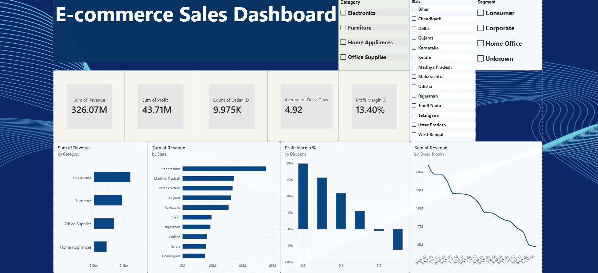

# E-commerce Sales Analysis & Dashboard
E-commerce sales data analysis and Power BI dashboard

Cleaned and analyzed a messy e-commerce dataset (9,985 orders across 5 sheets) using Python, then built an interactive Power BI dashboard on top. Found and flagged real data issues — like orders with 100% discount causing negative profit, and duplicate customer names — instead of just deleting them.

Key finding: discounts above 20% actually push orders into a loss, even though revenue looks fine on the surface.

Tools: Python (pandas, matplotlib), Power BI | Files: analysis.ipynb, cleaned_ecommerce_data.xlsx, dashboard_screenshot.png
